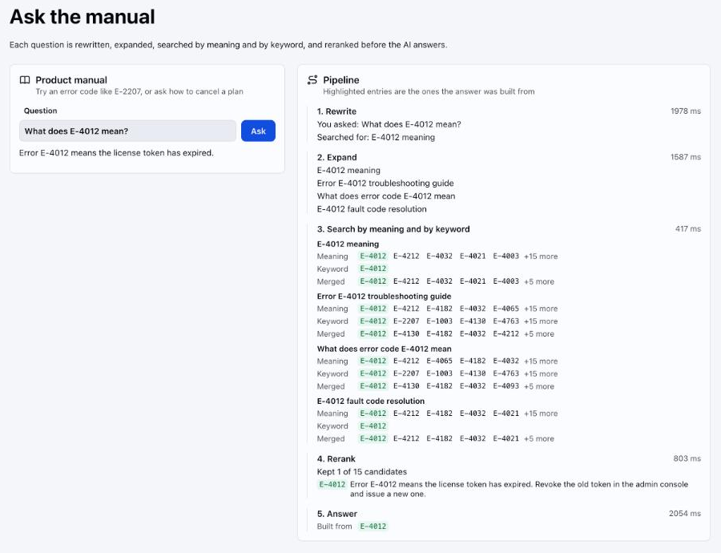

# AdvancedRag

An advanced retrieval augmented generation (RAG) demo built with webforJ and Spring AI, adding query rewriting, hybrid search and reranking to a question answering app.




## Overview

This app demonstrates a full Spring AI retrieval pipeline behind a webforJ view, and shows every step of it. Ask a question about a product manual of about 200 entries, most of them error codes that look alike. Each question is rewritten, expanded into several queries, searched by meaning and by keyword, and reranked before the AI answers. A pipeline panel next to the answer shows what each step returned and how long it took, and highlights the manual entries the answer was built from.

## Features

- **Query Rewriting**: `RewriteQueryTransformer` turns the raw question into a better search query
- **Multi-Query Expansion**: `MultiQueryExpander` adds three differently worded versions of the question
- **Hybrid Search**: `HybridRetriever` merges vector and keyword results with reciprocal rank fusion
- **Reranking**: `LlmReranker` asks the model to order the candidates and keeps the best five
- **Pipeline View**: Every stage is wrapped to record what it received and returned, and the view shows the rewritten question, the expanded queries, both search results, the merged list and the reranked entries
- **One Advisor**: Every stage is wired into a single `RetrievalAugmentationAdvisor`
- **Embedding Cache**: The manual is embedded once and cached in `.cache/`, so restarts cost no embedding calls
- **Background Work**: The pipeline runs in a Spring `@Async` method and the answer reaches a `MarkdownViewer` through `Environment.runLater`

## Tech Stack

- **Frontend**: webforJ 26.03
- **Backend**: Spring Boot 4.1.0 with Spring AI 2.0
- **LLM**: Google Gemini via Spring AI, with Gemini embeddings
- **Vector Store**: In-memory `SimpleVectorStore`
- **Build Tool**: Maven
- **Java Version**: 21

## Getting Started

### Prerequisites

- Java 21
- Maven 3.9+
- Gemini API key

### API Key Setup

This app uses Google Gemini for chat and embeddings. To get your API key:

1. Go to [Google AI Studio](https://aistudio.google.com/apikey)
2. Sign in with your Google account
3. Create a new API key
4. Export it twice in the terminal you run the app from, once for chat and once for embeddings:

```bash
export SPRING_AI_GOOGLE_GENAI_API_KEY=YOUR_API_KEY_HERE
export SPRING_AI_GOOGLE_GENAI_EMBEDDING_API_KEY=YOUR_API_KEY_HERE
```

### Running the App

1. Clone the repository:
```bash
git clone https://github.com/webforj/built-with-webforj.git
cd built-with-webforj/webforj-advancedrag
```

2. Run the application:
```bash
mvn
```

3. Open your browser and navigate to:
```
http://localhost:8080
```

### First Start

The first start embeds the 207 manual entries. On the Gemini free tier this hits the per-minute limit, so the app waits and retries, and startup can take a few minutes. The embeddings are then saved in `.cache/` (one file per embedding model), and later starts are instant.

## Measuring the Pipeline

`RetrievalEval` checks whether hybrid search ranks exact error codes better than vector search alone. It asks for 20 random error codes and reports where the right entry lands. It is not part of `mvn test` and runs only by name, with the embedding key set:

```bash
export SPRING_AI_GOOGLE_GENAI_EMBEDDING_API_KEY=YOUR_API_KEY_HERE
mvn test -Dtest=RetrievalEval
```

With `gemini-embedding-001`, vector search alone already ranked the right entry first for 20 of 20 codes, the same as hybrid search. Measure with your own data and embedding model before adding a stage.

## Learn More

- [webforJ Documentation](https://docs.webforj.com)
- [webforJ Background Jobs with Spring](https://docs.webforj.com/docs/integrations/spring/background-jobs)
- [Spring AI RAG Reference](https://docs.spring.io/spring-ai/reference/api/retrieval-augmented-generation.html)
