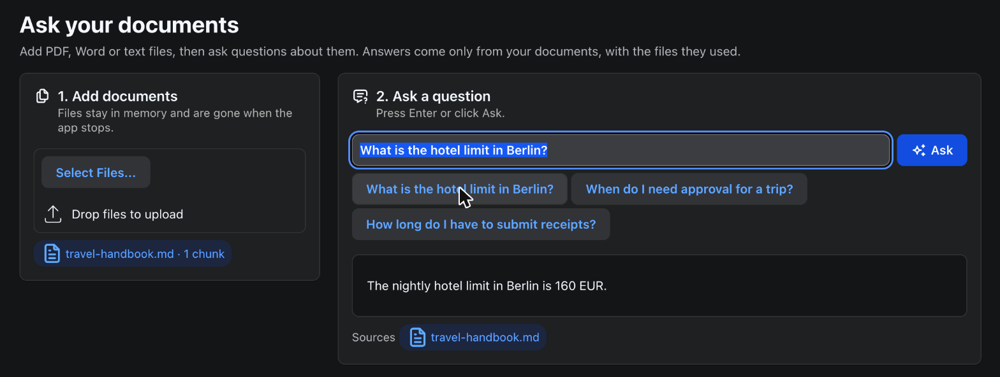

# AskDocs

Chat with your own documents, written entirely in Java. AskDocs is a small retrieval augmented generation (RAG) app built with webforJ and Spring AI: you add files, ask a question, and the answer comes only from those files, with the files it used listed underneath.




## What it teaches

- How RAG works, in one Spring service
- Uploading files with the webforJ `Upload` component and handing them to Spring AI
- Streaming a model's answer into a `MarkdownViewer` from a background thread with `Environment.runLater`
- Showing which documents an answer was based on
- Giving users clear states: empty, working (spinner), answered, failed

## How RAG works here

RAG has two flows. Both live in [`KnowledgeBase`](src/main/java/com/webforj/builtwithwebforj/askdocs/service/KnowledgeBase.java).

**Indexing**, when a document is added:

1. `TikaDocumentReader` reads the text out of a PDF, Word, Markdown or text file.
2. `TokenTextSplitter` cuts the text into chunks small enough to embed.
3. `VectorStore.add` turns every chunk into an embedding (a list of numbers that captures its meaning) with Gemini and keeps it in memory.

**Asking**, when a question comes in:

1. The `RetrievalAugmentationAdvisor` embeds the question and asks the vector store for the closest chunks (`topK(4)`, `similarityThreshold(0.5)`).
2. It adds those chunks to the prompt as context.
3. The system prompt tells the model to answer from that context only.

The retrieved chunks travel with the response, so the view can list the files the answer used.

## How the UI works

[`AskView`](src/main/java/com/webforj/builtwithwebforj/askdocs/views/AskView.java) is a single webforJ view with two cards.

- **Add documents** uses `Upload` with `AutoUpload.ALWAYS`, so files upload as soon as they are dropped. Each file is moved to a temporary folder under a unique name and passed to `KnowledgeBase.add`. *Try the sample handbook* loads [`travel-handbook.md`](src/main/resources/sample/travel-handbook.md) so you can try the app without a file of your own.
- **Ask a question** sends the question with Enter or the *Ask* button. A spinner shows while the documents are searched, then the answer streams into a `MarkdownViewer` and the sources appear as chips.

The answer arrives on a Reactor thread, not on the webforJ UI thread. The view captures the session's `Environment` before it starts the request and hands every UI change back with `Environment.runLater(env, ...)`:

```java
Environment env = Environment.getCurrent();
Set<String> used = new LinkedHashSet<>();
startAnswer();

kb.ask(text).subscribe(
    response -> {
      used.addAll(KnowledgeBase.sourcesOf(response));
      String chunk = response.chatResponse().getResult().getOutput().getText();
      Environment.runLater(env, () -> showChunk(chunk));
    },
    error -> Environment.runLater(env, () -> {
      showChunk("Sorry, the answer failed: " + error.getMessage());
      finishAnswer(Set.of());
    }),
    () -> Environment.runLater(env, () -> finishAnswer(used)));
```

All styling is in [`app.css`](src/main/frontend/app.css) and uses DWC design tokens, so the app follows light and dark mode.

## Getting started

### Prerequisites

- Java 21
- Maven 3.9+
- A Gemini API key from [Google AI Studio](https://aistudio.google.com/apikey).

### Run

Set the key in your environment, never in a file you commit:

```bash
export SPRING_AI_GOOGLE_GENAI_API_KEY=your-key
export SPRING_AI_GOOGLE_GENAI_EMBEDDING_API_KEY=your-key
```

Then start the app:

```bash
cd built-with-webforj/webforj-askdocs
mvn
```

Open `http://localhost:8080`, click *Try the sample handbook*, and click one of the example questions.

The models are set in [`application.properties`](src/main/resources/application.properties): `gemini-3.5-flash-lite` for answers and `gemini-embedding-001` for embeddings. Every question makes one embedding call and one chat call, and every added document makes one embedding call per chunk.

## Going further

- **Keep documents across restarts.** `SimpleVectorStore` lives in memory. Replace it with a database-backed `VectorStore` such as PGVector. Nothing else changes, because the rest of the code only sees the `VectorStore` interface.
- **Separate users.** Every user shares one knowledge base here. Store an owner in each chunk's metadata and filter with `VectorStoreDocumentRetriever.FILTER_EXPRESSION`.
- **Large files.** Indexing runs on the UI thread to keep the sample short. For big PDFs, run it in a Spring `@Async` method and report progress with `Environment.runLater`.

## A note on Guava

The Google GenAI client pulls in the Android build of Guava, which breaks the webforJ servlet at startup. The `pom.xml` pins the JRE build (`33.4.0-jre`) in `dependencyManagement` to fix it.

## Learn more

- [webforJ documentation](https://docs.webforj.com)
- [Upload component](https://docs.webforj.com/docs/components/upload)
- [MarkdownViewer component](https://docs.webforj.com/docs/components/markdownviewer)
- [Asynchronous updates](https://docs.webforj.com/docs/advanced/asynchronous-updates)
- [Spring AI: retrieval augmented generation](https://docs.spring.io/spring-ai/reference/api/retrieval-augmented-generation.html)
