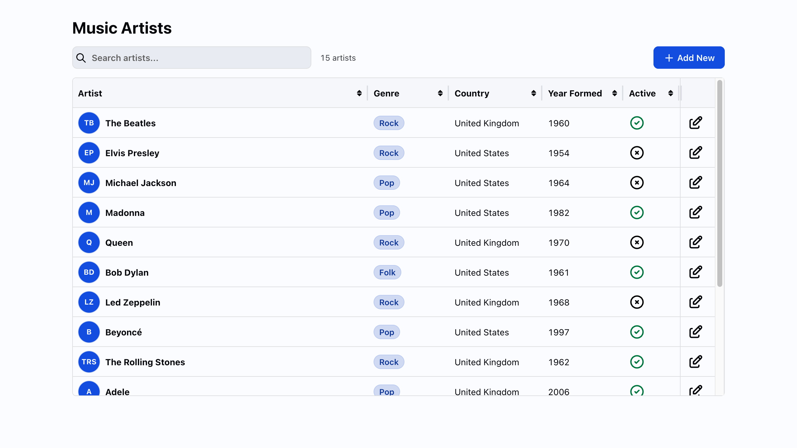

# CRUD

A music artist management app built with webforJ and Spring Boot.

%3D'webforj.version'%5D&label=webforJ&color=blue)
%3D'project'%5D%2F*%5Blocal-name()%3D'parent'%5D%2F*%5Blocal-name()%3D'version'%5D&label=Spring%20Boot&color=green)
%3D'maven.compiler.source'%5D&label=Java&color=orange)



## Overview

A table lists music artists, a search field narrows the list, and a dialog adds, edits and deletes entries. The data lives in an in-memory database and is loaded with sample artists at startup. It shows how webforJ components work with a Spring Boot backend.

## Features

- **Artist table**: Each artist is listed with an avatar built from their initials
- **Built-in renderers**: Avatars, badges, status icons and the edit button come from the table renderers that ship with webforJ
- **Sorting**: Click a column header and the database sorts the rows
- **Add, edit and delete**: A dialog creates and updates artists, and a confirmation dialog protects deletion. Open it from the edit button or by double-clicking a row
- **Search**: Filter the list by name, genre or country
- **Validation**: Form fields show validation messages
- **Data binding**: The dialog fields are bound to the artist record
- **Sample data**: The in-memory database is filled with sample artists when it is empty

## Getting started

### Prerequisites

- Java and Maven (see the badges for the Java version)

### Running the app

1. Clone the repository:
```bash
git clone https://github.com/webforj/built-with-webforj.git
cd built-with-webforj/webforj-crud
```

2. Run the application:
```bash
mvn
```

3. Open `http://localhost:8080` in your browser.

### Database console

To view the database directly while the app runs with `mvn`:

1. Open `http://localhost:8080/h2-console`
2. Use these connection settings:
   - JDBC URL: `jdbc:h2:mem:testdb`
   - Username: `sa`
   - Password: (leave empty)

## Learn more

- [Full-stack development with webforJ](https://docs.webforj.com/blog/Full-stack%20development%20with%20webforJ)
- [webforJ documentation](https://docs.webforj.com)
- [Table component](https://docs.webforj.com/docs/components/table/overview)
- [Table renderers](https://docs.webforj.com/docs/components/table/rendering)
- [Data binding](https://docs.webforj.com/docs/data-binding/overview)
- [Repository](https://docs.webforj.com/docs/advanced/repository/overview)
- [Spring Boot documentation](https://spring.io/projects/spring-boot)
