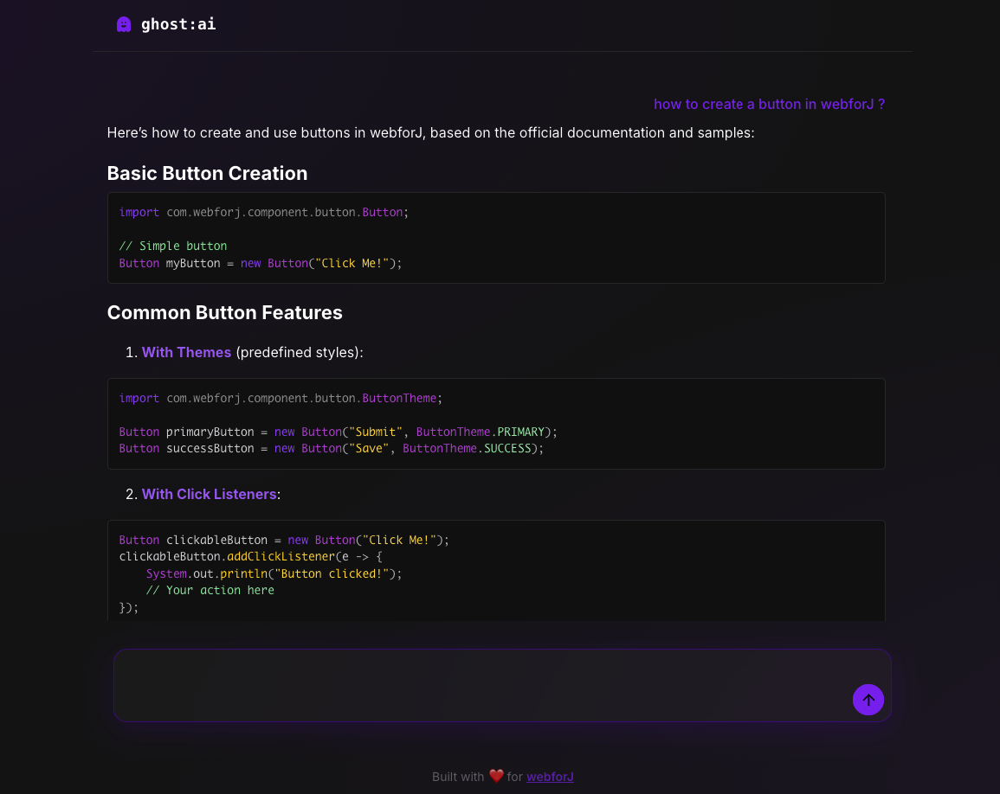

# ghost:ai

An AI chat demo built with webforJ, Spring Boot and Spring AI.

%3D'webforj.version'%5D&label=webforJ&color=blue)
%3D'project'%5D%2F*%5Blocal-name()%3D'parent'%5D%2F*%5Blocal-name()%3D'version'%5D&label=Spring%20Boot&color=green)
%3D'maven.compiler.source'%5D&label=Java&color=orange)



## Overview

This app shows how webforJ components fit an AI chat interface. Answers stream in as the model produces them, and the text area offers ghost text suggestions while you type. The assistant reads the webforJ documentation through an MCP server, so its answers about the framework come from current docs.

## Features

- **Streaming markdown**: The answer renders live as the model writes it
- **Syntax highlighting**: Code blocks in answers are highlighted
- **Predictive text**: Ghost text suggests a continuation while you type
- **Chat memory**: The conversation history carries across messages
- **MCP integration**: The assistant calls the webforJ MCP server as a tool
- **Auto-scroll**: The newest text stays in view as the answer streams

## Getting started

### Prerequisites

- Java and Maven (see the badges for the Java version)
- Google credentials for Gemini, either an API key or a Google Cloud project (see below)

### Google GenAI setup

Pick one of two ways to connect.

#### Gemini API key
1. Go to [Google AI Studio](https://aistudio.google.com/apikey)
2. Create an API key
3. Export it in the terminal you run the app from:

```bash
export SPRING_AI_GOOGLE_GENAI_API_KEY=YOUR_API_KEY_HERE
```

#### Google Cloud project (Vertex AI)
1. Use a Google Cloud project with the Vertex AI API enabled
2. Make Google Cloud credentials available to the app
3. Export the project ID and region:

```bash
export SPRING_AI_GOOGLE_GENAI_PROJECT_ID=YOUR_PROJECT_ID
export SPRING_AI_GOOGLE_GENAI_LOCATION=us-central1
```

When an API key is set, the app uses the Gemini Developer API. Otherwise it uses Vertex AI with the project ID and location.

The MCP connection to `https://mcp.webforj.com` needs no key.

### Running the app

1. Clone the repository:
```bash
git clone https://github.com/webforj/built-with-webforj.git
cd built-with-webforj/webforj-ghostai
```

2. Run the application:
```bash
mvn
```

3. Open `http://localhost:8080` in your browser.

## Learn more

- [Adding an AI chat feature to a Java app](https://docs.webforj.com/blog/add-ai-to-java-app)
- [webforJ documentation](https://docs.webforj.com)
- [TextArea component](https://docs.webforj.com/docs/components/textarea)
- [MarkdownViewer component](https://docs.webforj.com/docs/components/markdownviewer)
- [webforJ MCP server](https://docs.webforj.com/docs/ai-tooling/mcp)
- [Spring AI Google GenAI chat](https://docs.spring.io/spring-ai/reference/api/chat/google-genai-chat.html)
- [Spring AI MCP client](https://docs.spring.io/spring-ai/reference/api/mcp/mcp-client-boot-starter-docs.html)
