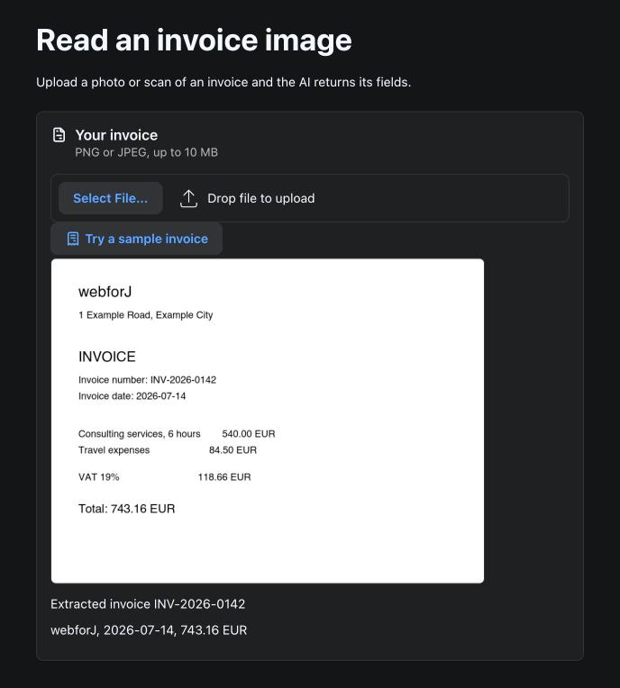

# InvoiceReader

An invoice extraction demo built with webforJ and Spring AI, turning an invoice image into typed Java fields.




## Overview

This app demonstrates the webforJ `Upload` component together with a vision-capable model through Spring AI. Upload a photo or scan of an invoice, and the AI returns the vendor, invoice number, date, currency and total as a Java record. There is no separate OCR library and no text parsing step.

## Features

- **Image Upload**: The `Upload` component accepts one PNG or JPEG of up to 10 MB and sends it as soon as it is picked or dropped
- **Sample Invoice**: A bundled sample invoice lets you try the app without your own file
- **Image Preview**: The uploaded invoice shows in the page while the AI reads it
- **Structured Output**: Gemini reads the image, and Spring AI maps the answer to an `InvoiceData` record with `.entity()`
- **Background Work**: The model call runs on a worker thread and updates the UI with `Environment.runLater`
- **Cleanup**: The image is deleted as soon as the model has read it

## Tech Stack

- **Frontend**: webforJ 26.03
- **Backend**: Spring Boot 4.1.0 with Spring AI 2.0
- **LLM**: Google Gemini via Spring AI
- **Build Tool**: Maven
- **Java Version**: 21

## Getting Started

### Prerequisites

- Java 21
- Maven 3.9+
- Gemini API key

### API Key Setup

This app uses Google Gemini as the LLM. To get your API key:

1. Go to [Google AI Studio](https://aistudio.google.com/apikey)
2. Sign in with your Google account
3. Create a new API key
4. Export it in the terminal you run the app from:

```bash
export SPRING_AI_GOOGLE_GENAI_API_KEY=YOUR_API_KEY_HERE
```

### Running the App

1. Clone the repository:
```bash
git clone https://github.com/webforj/built-with-webforj.git
cd built-with-webforj/webforj-invoicereader
```

2. Run the application:
```bash
mvn
```

3. Open your browser and navigate to:
```
http://localhost:8080
```

## Learn More

- [webforJ Documentation](https://docs.webforj.com)
- [webforJ Upload Component](https://docs.webforj.com/docs/components/upload)
- [Spring AI Documentation](https://docs.spring.io/spring-ai/reference/)
