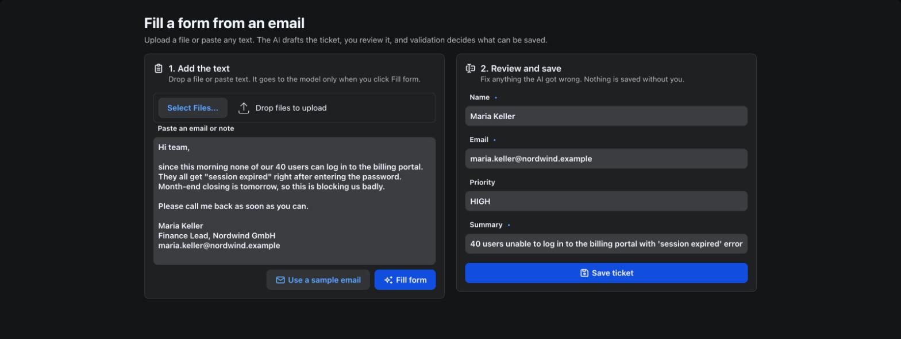

# SmartForm

A form-filling demo built with webforJ and Spring AI, turning an email or document into a validated support ticket.

%3D'webforj.version'%5D&label=webforJ&color=blue)
%3D'project'%5D%2F*%5Blocal-name()%3D'parent'%5D%2F*%5Blocal-name()%3D'version'%5D&label=Spring%20Boot&color=green)
%3D'maven.compiler.source'%5D&label=Java&color=orange)



## Overview

This app demonstrates webforJ data binding together with Spring AI structured output. Paste an email or drop a file, and the AI drafts a support ticket. The user reviews the fields, and validation rules decide what can be saved.

## Features

- **AI form filling**: The model extracts the ticket fields into the form
- **File upload**: Reads PDF, Word, email and text files
- **Data binding**: The form fields are bound to the ticket by name
- **Validation**: The same rules check typed and AI-filled values
- **Background work**: The model call runs off the UI thread and the page updates when it finishes
- **Human in the loop**: Nothing is saved until the user reviews the ticket and clicks Save

## Getting started

### Prerequisites

- Java and Maven (see the badges for the Java version)
- A Gemini API key from [Google AI Studio](https://aistudio.google.com/apikey)

### API key setup

1. Go to [Google AI Studio](https://aistudio.google.com/apikey)
2. Sign in with your Google account
3. Create a new API key
4. Export it in the terminal you run the app from:

```bash
export SPRING_AI_GOOGLE_GENAI_API_KEY=YOUR_API_KEY_HERE
```

### Running the app

1. Clone the repository:
```bash
git clone https://github.com/webforj/built-with-webforj.git
cd built-with-webforj/webforj-smartform
```

2. Run the application:
```bash
mvn
```

3. Open `http://localhost:8080` in your browser.

## Learn more

- [AI form filling in Java](https://docs.webforj.com/blog/ai-form-filling-java)
- [webforJ documentation](https://docs.webforj.com)
- [Data binding](https://docs.webforj.com/docs/data-binding/overview)
- [Upload component](https://docs.webforj.com/docs/components/upload)
- [Spring AI structured output](https://docs.spring.io/spring-ai/reference/api/structured-output-converter.html)
