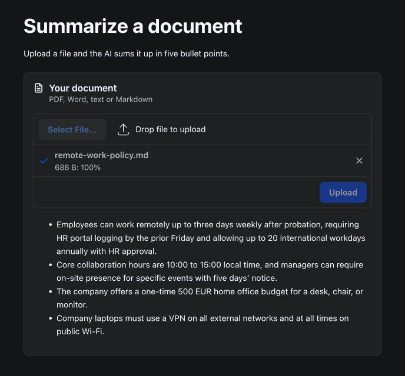

# Summarize

A document summary demo built with webforJ and Spring AI, turning an uploaded file into a short bullet point summary.




## Overview

This app demonstrates the webforJ `Upload` component together with Spring AI. Drop a PDF, Word, text or Markdown file, and the AI sums it up in at most five bullet points. The whole flow is three Java classes, with no REST controller and no JavaScript.

## Features

- **File Upload**: The `Upload` component sends the file to the server as soon as it is picked or dropped
- **Text Extraction**: Apache Tika reads the text out of PDF, Word, text and Markdown files
- **AI Summary**: Gemini summarizes the first 12,000 characters of the document through a Spring AI `ChatClient`
- **Markdown Output**: The summary renders in a `MarkdownViewer`, so the bullet points show as a list
- **Background Work**: The model call runs in a Spring `@Async` method and updates the UI with `Environment.runLater`
- **Cleanup**: The uploaded file is deleted as soon as it has been summarized

## Tech Stack

- **Frontend**: webforJ 26.03
- **Backend**: Spring Boot 4.1.0 with Spring AI 2.0
- **LLM**: Google Gemini via Spring AI
- **Build Tool**: Maven
- **Java Version**: 21

## Getting Started

### Prerequisites

- Java 21
- Maven 3.9+
- Gemini API key

### API Key Setup

This app uses Google Gemini as the LLM. To get your API key:

1. Go to [Google AI Studio](https://aistudio.google.com/apikey)
2. Sign in with your Google account
3. Create a new API key
4. Export it in the terminal you run the app from:

```bash
export SPRING_AI_GOOGLE_GENAI_API_KEY=YOUR_API_KEY_HERE
```

### Running the App

1. Clone the repository:
```bash
git clone https://github.com/webforj/built-with-webforj.git
cd built-with-webforj/webforj-summarize
```

2. Run the application:
```bash
mvn
```

3. Open your browser and navigate to:
```
http://localhost:8080
```

## Learn More

- [webforJ Documentation](https://docs.webforj.com)
- [webforJ Upload Component](https://docs.webforj.com/docs/components/upload)
- [Spring AI Documentation](https://docs.spring.io/spring-ai/reference/)
