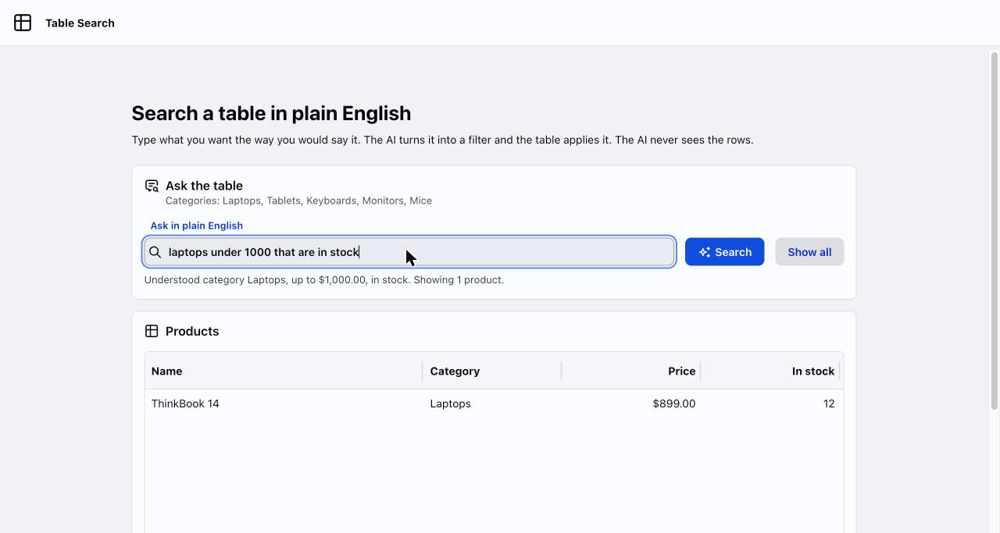

# Table Search

A natural language search demo built with webforJ and Spring AI. Type a sentence such as "laptops under 1000 that are in stock" and the table filters itself.

%3D'webforj.version'%5D&label=webforJ&color=blue)
%3D'project'%5D%2F*%5Blocal-name()%3D'parent'%5D%2F*%5Blocal-name()%3D'version'%5D&label=Spring%20Boot&color=green)
%3D'maven.compiler.source'%5D&label=Java&color=orange)



## Overview

This app demonstrates natural language search over a webforJ Table. The model never sees the rows and never writes a query. It only fills a small Java record with optional fields: category, name, minimum price, maximum price and stock. Plain Java turns that record into a filter for the table's repository, so everything after the model call is ordinary code you can read and test.

## Features

- **Plain English search**: Type a sentence and press Enter or Search
- **Typed filter**: Spring AI parses the reply into a `ProductQuery` record
- **Safe by design**: The model only picks values, your code builds the filter
- **Shows what it understood**: The line under the search box spells out the parsed filter and the number of matches
- **Unknown values caught**: A category that isn't in the catalog gets a message instead of an empty table
- **Background work**: The model call runs off the UI thread and the page updates when it finishes
- **Responsive layout**: The search bar and table adapt to narrow screens

## Getting started

### Prerequisites

- Java and Maven (see the badges for the Java version)
- A Gemini API key from [Google AI Studio](https://aistudio.google.com/apikey)

### API key setup

1. Go to [Google AI Studio](https://aistudio.google.com/apikey)
2. Sign in with your Google account
3. Create a new API key
4. Export it in the terminal you run the app from:

```bash
export SPRING_AI_GOOGLE_GENAI_API_KEY=YOUR_API_KEY_HERE
```

### Running the app

1. Clone the repository:
```bash
git clone https://github.com/webforj/built-with-webforj.git
cd built-with-webforj/webforj-tablesearch
```

2. Run the application:
```bash
mvn
```

3. Open `http://localhost:8080` in your browser and try "cheap keyboards" or "monitors in stock".

## Learn more

- [Natural language search for a Java table](https://docs.webforj.com/blog/ai-table-natural-language-search)
- [webforJ documentation](https://docs.webforj.com)
- [Table component](https://docs.webforj.com/docs/components/table/overview)
- [Table filtering](https://docs.webforj.com/docs/components/table/filtering)
- [Spring AI structured output](https://docs.spring.io/spring-ai/reference/api/structured-output-converter.html)
