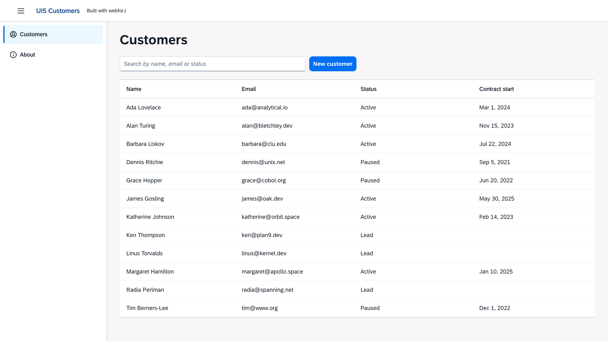

# UI5

A customer management app built with webforJ and Spring Boot, where everything on the screen comes from the SAP UI5 Web Components design system.

%3D'webforj.version'%5D&label=webforJ&color=blue)
%3D'project'%5D%2F*%5Blocal-name()%3D'parent'%5D%2F*%5Blocal-name()%3D'version'%5D&label=Spring%20Boot&color=green)
%3D'maven.compiler.source'%5D&label=Java&color=orange)



## Overview

webforJ works with the design system a team already has. This app takes the UI5 Web Components from npm, wraps each one once as a typed Java component, and builds the whole UI from those wrappers. The views are plain webforJ: routing, data binding and validation work with the UI5 controls the same way they work with the built-in components.

## Features

- **UI5 shell**: A shell bar and a side navigation frame the app, and the navigation highlights the current section
- **Customer table**: Customers are listed with email, status and contract start, and a click on a row opens the customer
- **Search**: The list narrows once you pause typing a name, an email address or a status
- **Customer form**: Name, email, status, contract start and newsletter, bound to the customer with webforJ data binding
- **Validation**: A missing or invalid value shows the UI5 error state and message on its field
- **Confirm before delete**: A UI5 dialog asks before a customer is removed
- **Notifications**: A UI5 toast confirms every save and delete

## How it works

Three steps bring a design system into a webforJ app. Each one has a short example in the code.

1. **Install the package.** A component names the npm package and the module that registers its custom element. The webforJ bundler installs the package at build time, and the browser loads the module the first time the component is created.

   ```java
   @BundlePackage(value = Ui5.PACKAGE, version = Ui5.VERSION) // "@ui5/webcomponents", "^2.28.1"
   @BundleEntry("@ui5/webcomponents/dist/Switch.js")
   @NodeName("ui5-switch")
   public class Ui5Switch extends Ui5Field<Ui5Switch, Boolean> {
   ```

2. **Wrap the element.** A wrapper extends `ElementComposite` and maps the element's properties, slots and events to Java. [`Ui5Button`](src/main/java/com/webforj/builtwithwebforj/ui5/components/Ui5Button.java) is the smallest complete example.

3. **Implement the webforJ concerns.** A concern is the interface webforJ uses for one capability, such as `HasText`, `HasEnablement`, `HasPlaceholder` or `HasVisibility`. Each wrapper implements the concerns its element supports, so it has the same setters as a built-in component, and craftforJ can show and edit those properties in the running app. [`Ui5Field`](src/main/java/com/webforj/builtwithwebforj/ui5/components/Ui5Field.java) implements `HasValue` and [`Ui5ValidatedField`](src/main/java/com/webforj/builtwithwebforj/ui5/components/Ui5ValidatedField.java) implements `InvalidAware`. That is all webforJ data binding needs, so [`CustomerFormView`](src/main/java/com/webforj/builtwithwebforj/ui5/views/CustomerFormView.java) binds and validates UI5 controls with one line.

Where to look:

| Path | What is in it |
| --- | --- |
| `src/main/java/.../components` | The UI5 wrappers, one class per component |
| `src/main/java/.../views` | The app shell and the three views, built only from the wrappers |
| `src/main/java/.../customers` | The customer, its validation rules and an in-memory service |
| `src/main/frontend/app.css` | The page layout, and the rule that keeps the page from flashing while the UI5 scripts load |

## Getting started

### Prerequisites

- Java and Maven (see the badges for the Java version)

### Running the app

1. Clone the repository:
```bash
git clone https://github.com/webforj/built-with-webforj.git
cd built-with-webforj/webforj-ui5
```

2. Run the application:
```bash
mvn
```

3. Open `http://localhost:8091` in your browser.

## Learn more

- [webforJ documentation](https://docs.webforj.com)
- [Web components in Java](https://docs.webforj.com/docs/building-ui/element-composite)
- [Frontend bundler](https://docs.webforj.com/docs/managing-resources/bundler/overview)
- [Data binding](https://docs.webforj.com/docs/data-binding/overview)
